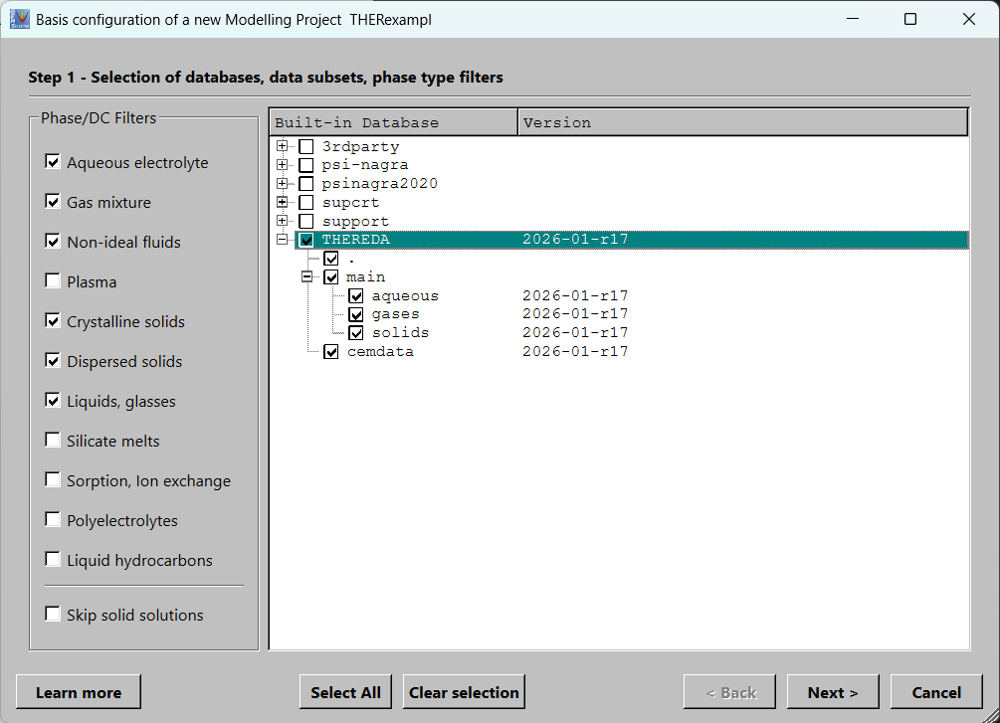
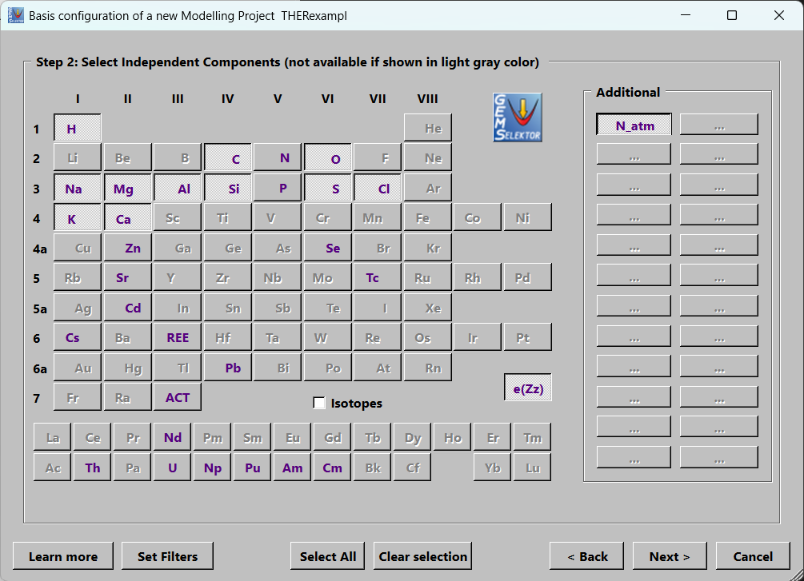
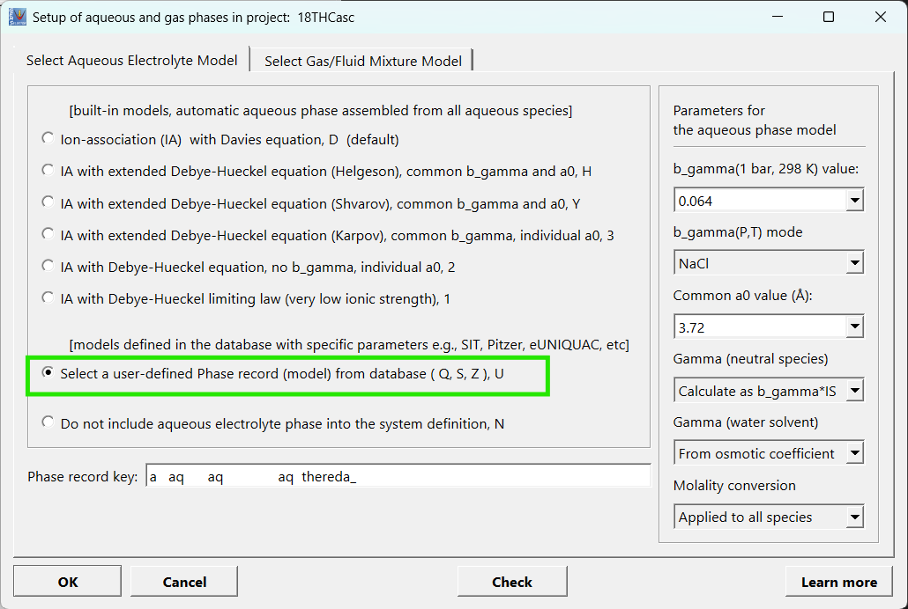
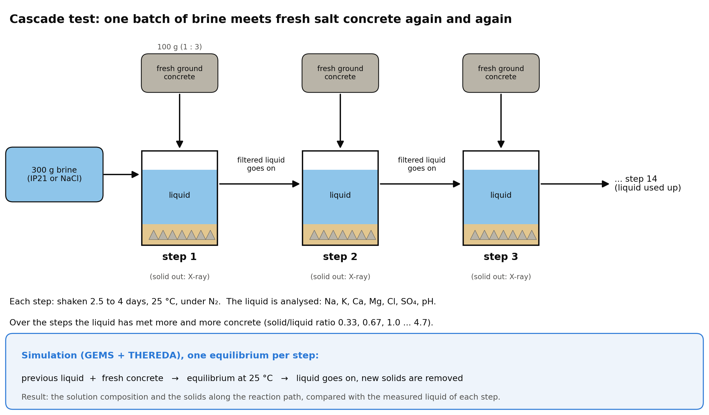
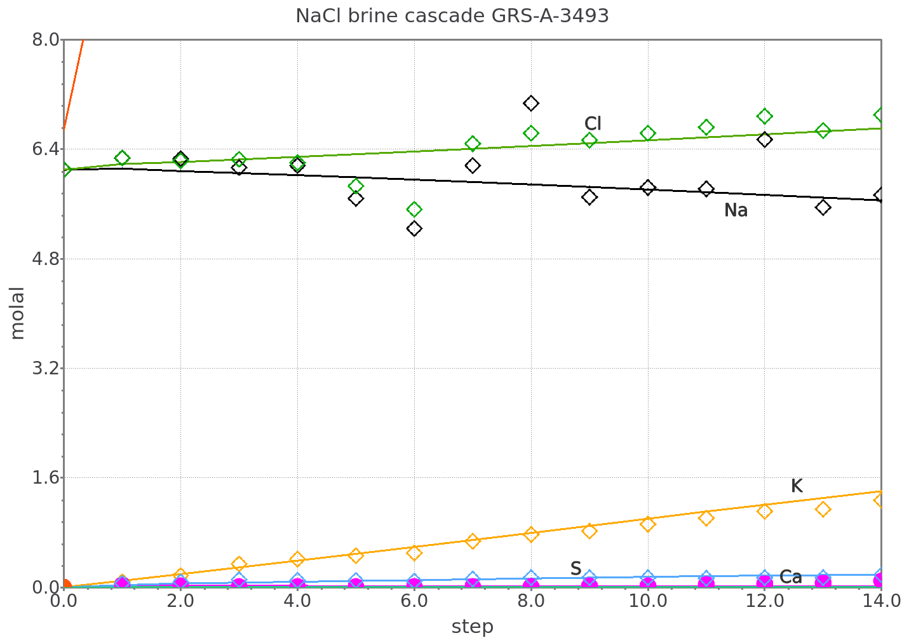
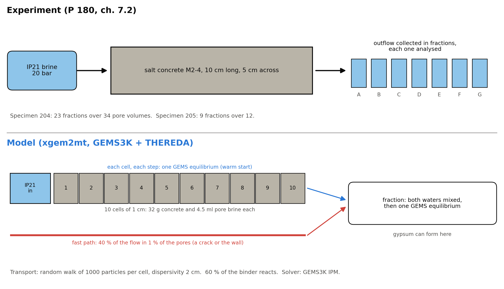
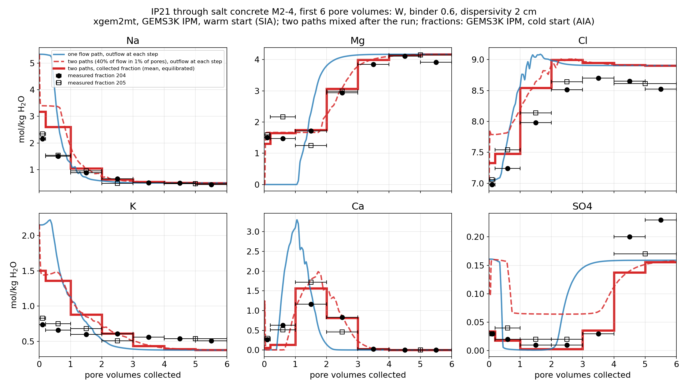

# Model salt systems with GEMS and THEREDA

Since version [3.12.2](../start/gemselektor/download.md) GEMS with [THEREDA](https://www.thereda.de) database can be used to model saline systems by taking advantage of the Pitzer activity model formalisms and the high quality internally consistent parameter set provided in the THEREDA database[@MOOG2026].

Typical applications:

- **Nuclear waste repositories in salt:** brine evolution and radionuclide solubility in concentrated solutions.
- **Barrier materials:** reaction of brines with cement and salt concrete, as in the example below.
- **Salt systems:** mineral solubility, and the salt sequence as seawater or other brines evaporate.
- THEREDA comes with the GEMS installer. Select it when you create a project.

## Get started

*Steps 1 to 3: the THEREDA database files, the elements, and the Pitzer aqueous phase. Click a picture to enlarge it.*

1. Select *Project > New* and give the project a name. In step 1, tick **THEREDA** in the list of built-in databases. Untick *cemdata* if cement phases are not needed.

2. In step 2, select the elements of your system. Add *N_atm* (inert nitrogen) if you need an inert component.

    !!! warning "Choose all elements now"
        An element can only be added later by cloning the project (a new project with this one as template). An element that is used only in a later *Process* (for example Ca added to a NaCl brine) must be in the system from the start with a trace amount (1e-9 mol). Otherwise the run stops with "No Ca IComp in the system".

3. In the aqueous phase dialog, select **Select a user-defined Phase record (model) from database**. The THEREDA Pitzer aqueous phase is a phase record in the database. Click *Check*, then *OK*.

4. Enter the bulk composition, T and P of your system, then calculate it. Use *Process* to follow a reaction path, such as evaporation or stepwise reaction.

*For the oceanic salt system, THEREDA is applicable in the temperature range from 0 to 110 °C, for some subsystems even beyond. As such, THEREDA is the only database in the world that polythermally covers the entire system of oceanic salts including alkaline and acid conditions. The current radionuclide selection includes actinides (Th, U, Np, Pu, Am, Cm) and fission products (Se, Sr, Tc, Cs). There is also data for some heavy metals (Pb, Zn, Cd) available. The majority of the data for these radionuclides is valid for 25 °C.*

## Example project: TestTHERE

TestTHERE is a GEMS project built from THEREDA r17. It contains:

- the cascade test, with the measured points on the plots
- seawater evaporation, where halite appears after 92 % of the water is removed
- 8 Processes with solubility curves of salt systems and experimental points

## Example: leaching salt concrete with brine

{ width="800" }

In the GRS cascade test (GRS-A-3493)[@MEYER2003], one batch of brine reacts with fresh ground salt concrete, step after step, at 25 °C until the brine is exhausted. 

The project **TestTHERE** models this test with one equilibrium per step, in a *Process* with the sequential-reactor option.

| Brine | Start system (*SysEq*) | *Process* | Plots | Brine and concrete (*Compos*) |
|---|---|---|---|---|
| IP21 | `Casc_S00` | `Cascade` | `Cascade` (all elements and pH), `CascSO4` (SO4 alone) | `BrIP21`, `CemIP21` |
| Saturated NaCl | `Casc_N00` | `CascNaCl` | `CascNaCl` (all elements and pH), `CascNaClSO4` (SO4 alone) | `BrNaCl`, `CemNaCl` |

To see the example in GEM-Selektor, open TestTHERE, select the Process (for example `TestTHERE:G:Casc_S00:0:0:1:25:0:Cascade:S:`), and calculate it. The 15 points are step 0 (the brine alone) to step 14. There are two cases: a saturated NaCl brine and the Mg-rich IP21 brine.

_cascade_.png>)

*Lines are the GEMS model and symbols are the measured points. The orange curve is pH, on the same axis. The NaCl brine follows the measurements closely. With IP21, the model trends match, but Mg and Cl are higher than measured.*

!!! note "What was fitted"
    The reacting part of the binder is fitted, and portlandite, hydrotalcite, LDH and ettringite were kept out of the calculation. Al-trichloride phase isn't in THEREDA but is discussed in the report: it was added with a log K fitted to this test series. This serves as an example of what can be calculated and should not be taken as a final result.

## Reactive transport: brine through a salt concrete column

xgem2mt is the GEM2MT module of GEM-Selektor as a C++ library with a Python interface: it reads the GEMS3K files exported from GEM-Selektor, moves pore water between cells, and calculates a full GEMS equilibrium in every cell at every time step.

In this experiment (GRS-A-3493, ch. 7.2)[@MEYER2003], IP21 brine is pressed through a 10 cm cylinder of salt concrete M2-4 and the outflow is analysed fraction by fraction. The model has 10 cells and two flow paths: a slow flow through the concrete and a fast flow through a crack or along the wall. A run of 6 pore volumes (one pore volume is the brine that fills the pores of the column once) is about 10 000 equilibria.

{ width="800" }

{ width="800" }

*Blue line: one flow path. Dashed red line: two flow paths, outflow at each step. Thick red steps: two flow paths, each collected fraction mixed and equilibrated. Black symbols: measured fractions.*

Three cases were calculated:
First, with one flow path (blue line), Mg arrives too late and the Ca peak too early. Second, with two paths (dashed red line), Mg is already in the first fraction and the Ca peak moves to about 2 pore volumes, but sulfate stays near 0.065 mol/kg, about three times the measured value. Third, collected solution form the two paths is mixed and equilibrated (thick red steps), gypsum precipitates in the fraction, and sulfate stays low up to 4 pore volumes, as measured.

!!! note "What was fitted"
    The fast path (**40 % of the flow in 1 % of the pores**) and the **reacting part of the binder** are fitted. The model still gives too much K at the start, and Cl is 0.3–0.5 mol/kg too high. This serves as an example of what can be calculated and should not be taken as a final result.

This and other Python examples with GEMS are in the [xgems-jupyter](https://github.com/gemshub/xgems-jupyter) repository.

## Links

[THEREDA home page](https://www.thereda.de) · [GEMS databases](../start/gemselektor/databases.md) · [xgems-jupyter](https://github.com/gemshub/xgems-jupyter) · [Ask in GEMS discussions](https://github.com/orgs/gemshub/discussions)
